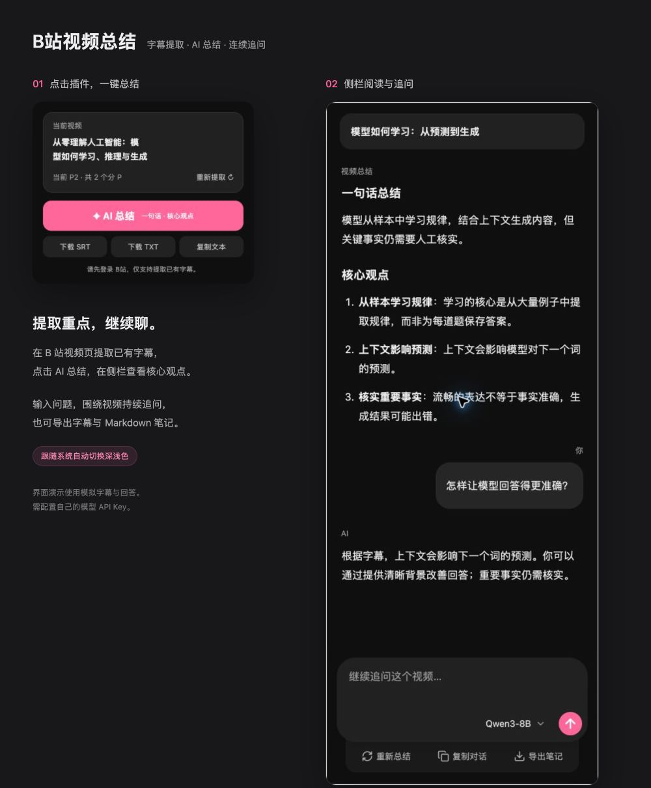

# B站视频总结

一个轻量的 Chrome 插件：提取 B 站视频已有字幕，在侧栏一键总结，并围绕视频持续追问。

原生 JavaScript · Manifest V3 · 无需构建 · API 直连



*深色模式演示，字幕与回答为模拟内容。*

## 功能

- 自动识别当前视频与分 P，提取默认字幕。
- 总结只包含「一句话总结」和「核心观点」。
- 原生侧栏对话，流式输出、Markdown 展示、停止与重试。
- 输入框内切换模型；支持智谱和硅基流动，可配置多个模型 ID。
- 导出 SRT / TXT 字幕，复制对话或导出 Markdown 笔记。
- B站粉色主题，跟随系统自动切换深浅色。

## 安装

要求 Chrome 116 或以上。

1. 从 [Releases](https://github.com/wildematt/bilibili-video-summary/releases/latest) 下载插件 ZIP 并解压。
2. 打开 `chrome://extensions`，开启「开发者模式」。
3. 点击「加载已解压的扩展程序」，选择包含 `manifest.json` 的文件夹。
4. 登录 B 站，打开普通 BV 视频页，点击工具栏中的插件。

也可以克隆本仓库，直接加载仓库根目录。更新时覆盖原目录后刷新扩展，使用同一个扩展可保留本机模型配置。

## 配置模型

提取字幕后点击「AI 总结」。在侧栏输入框的模型菜单中打开「设置模型与 API」，选择服务商，填写你自己的 API Key；模型 ID 每行一个。保存后即可从输入框切换模型。

| 服务商 | 默认模型 | 获取 Key |
| --- | --- | --- |
| 智谱 | `glm-4.7-flash` | [开放平台](https://open.bigmodel.cn/) |
| 硅基流动 | `Qwen/Qwen3-8B` | [控制台](https://cloud.siliconflow.cn/) |

项目不提供 API Key。模型可用性、价格及额度以服务商为准；添加模型前请确认账户权限和费用。请求仅发送至以上服务商的官方地址，暂不支持自定义中转地址。

Enter 发送追问，Shift+Enter 换行。切换模型仅影响下一次请求，不自动重新总结。

## 数据与隐私

- API Key 保存在本机 `chrome.storage.local`，不进行云同步，不包含在源码或发布包中；可在设置中删除。
- 点击总结或发送问题时，视频标题、字幕和所需聊天上下文会发送给所选模型服务商；Key 仅用于该服务商的请求认证。
- 字幕提取使用浏览器现有的 B 站登录态，不读取原始 Cookie，不向模型服务商发送 B 站 Cookie。
- 对话保存在浏览器会话存储中；浏览器关闭或扩展重载后可能清除，重要内容请导出。
- 无统计脚本、无项目自建中转服务器。浏览器本机扩展存储并非加密保险箱。

## 支持范围与限制

支持普通 BV 视频及当前分 P。视频需要已有可访问字幕；没有字幕时不会进行语音转写。暂不支持番剧、直播和批量下载。

长视频会分段总结再合并，追问会选取相关字幕片段。生成结果仅依据字幕，重要信息请对照视频核实。服务商限流、模型响应速度和 B 站接口变化可能影响使用。

## 开发

无需 npm 安装或构建。使用 Node.js 24+ 运行测试：

```sh
node --test tests/*.test.mjs
```

- `popup.*`：字幕提取与侧栏入口。
- `sidepanel.*`：模型设置、总结和对话 UI。
- `background.js`：B 站请求桥接。
- `modules/api.js`、`wbi.js`、`subtitles.js`：视频与字幕处理。
- `modules/summary.js`、`chat.js`：模型请求、流式输出和上下文。
- `modules/markdown.js`：安全 Markdown 展示。

自动化测试使用模拟请求，不需要真实 API Key。请勿把真实 Key、Cookie、浏览器配置或 `.env` 文件提交到仓库，也不要贴到 Issue。

## 许可证与致谢

项目代码采用 [MIT License](LICENSE)。界面图标使用 [Lucide](https://lucide.dev/)，其许可证见 [licenses/Lucide.txt](licenses/Lucide.txt)。插件应用图标为本项目生成的素材。

本项目由社区独立开发，与哔哩哔哩、智谱、硅基流动及 OpenAI 无官方关联。
